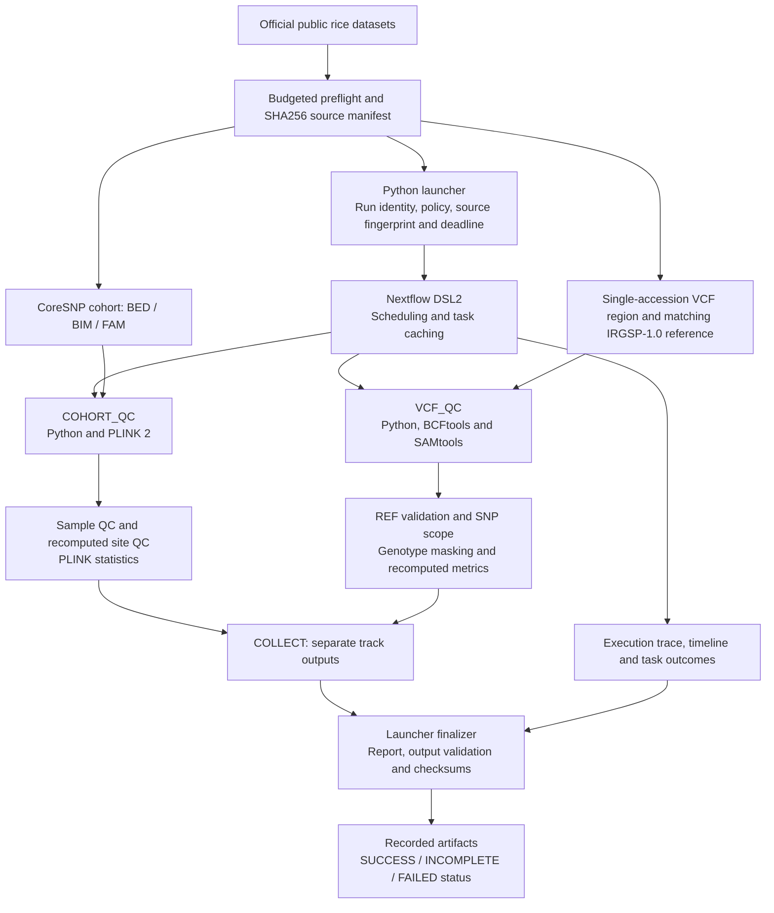
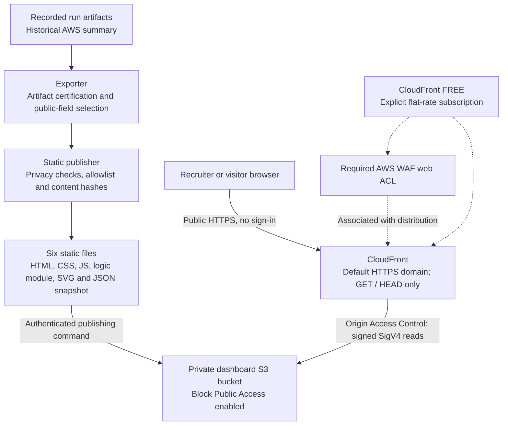

# RiceFlow

CPU-only Nextflow DSL2 rice QC with Python, PLINK 2, BCFtools/HTSlib, SAMtools and Docker. The existing
architecture keeps the already filtered/pruned CoreSNP cohort separate from individual-accession VCF
quality processing. The summaries share a report; the inputs never become an invented joint-called cohort.

**[Open the public RiceFlow dashboard](https://d35x4x7bn6ghj.cloudfront.net/)** ·
[Scientific assumptions](docs/SCIENTIFIC_ASSUMPTIONS.md) ·
[Validation evidence](docs/VALIDATION_RESULTS.md) ·
[AWS dashboard deployment](infra/dashboard/README.md)

## Architecture

RiceFlow has two execution boundaries: a CPU-only scientific workflow produces recorded evidence,
and a static website publishes a sanitized snapshot of that evidence. Opening the dashboard reads
static files; it does not submit jobs, query AWS APIs or recalculate scientific results.

### Scientific workflow



The cohort and VCF tasks operate independently; collection brings their outputs into one report.
The launcher checks source identity, artifact hashes and output consistency before atomically publishing
`SUCCESS.json`. A missing mandatory track or failed task retains its recorded incomplete or failed status.
Nextflow owns scheduling and resume caching. Input identities, policy values and source fingerprints
participate in task inputs so a changed policy or implementation cannot silently reuse stale results.

Local execution uses the native or Docker profile. The separate AWS execution configuration uses a
Nextflow controller, CPU-only AWS Batch EC2 workers, ECR images and a private science-data S3 bucket.
That path is used only for explicitly authorized pipeline runs; it is independent of dashboard hosting.
See the [detailed architecture](docs/ARCHITECTURE.md) and [pipeline AWS runbook](docs/AWS_RUNBOOK.md).

### Public dashboard hosting



The browser handles run selection, sample search, variant filters, policy comparisons, downloads and
local snapshot import. Imported data stays in browser memory. Provenance links open the original
evidence in this public GitHub repository. There is no application server, database or dashboard backend.

The CloudFormation stack declares the Free subscription explicitly. The publisher verifies an active
`FREE` plan before uploads and enables the distribution only after enrollment is verified. The S3
bucket policy permits origin reads from this distribution alone. Only the six dashboard files are
published; raw genomic inputs, credentials, tests, logs and deployment receipts stay out of the origin.

| Component | Repository location | Responsibility |
| --- | --- | --- |
| Scientific launcher and QC | [`src/riceflow/`](src/riceflow/) | Preflight, policy semantics, metrics, report generation and final status |
| Workflow and task modules | [`workflows/`](workflows/), [`modules/`](modules/), [`nextflow.config`](nextflow.config) | Scheduling, tool execution, resource limits and caching |
| Recorded evidence | [`reports/`](reports/), [`reports/validation-summary.json`](reports/validation-summary.json) | Historical manifests, checksums, metrics and validation results |
| Read-only dashboard | [`dashboard/`](dashboard/) | Browser UI, filters, comparisons and local import/export |
| Snapshot exporter and static build | [`scripts/export_dashboard.py`](scripts/export_dashboard.py), [`scripts/publish_dashboard.py`](scripts/publish_dashboard.py) | Certified evidence export, privacy checks and six-file build |
| Dashboard infrastructure | [`infra/dashboard/`](infra/dashboard/), [`scripts/dashboard_aws.py`](scripts/dashboard_aws.py) | Private S3, OAC, CloudFront, WAF, Free-plan verification, updates and scoped teardown |
| Optional pipeline infrastructure | [`infra/terraform/`](infra/terraform/) | Separately authorized AWS Batch workflow execution |
| CI | [Pipeline checks](.github/workflows/ci.yml), [dashboard checks](.github/workflows/dashboard.yml) | Scientific fixtures and static dashboard validation; dashboard updates do not launch the pipeline |

## Run locally

The 2026-10-27 follow-up audit resolved reference access through RAP-DB's current official NARO HTTPS
hostname, verified the publisher checksum and all observed REF bases, and completed the real VCF track.
The [dataset evidence](DATASET_VALIDATION.md) explains the TLS diagnosis and exact assembly identity.

```bash
make setup                         # project-local pinned tools; Java 17.0.20 and uv required
make test workflow-test             # offline fixtures plus nf-test
make recovery                       # synthetic failure → UUID resume → policy invalidation
make preflight                      # new timestamped outputs; verify/reuse available attested caches
make demo                           # new synthetic two-track report
make real-demo                      # recorded local real config: both tracks now required
make lint cloud-validate             # local checks; Terraform backend disabled, no deployment
```

For a fresh checkout, run preflight and use its generated configuration, rather than assuming this
machine's cached paths exist:

```bash
make preflight PREFLIGHT_OUT=data/my-preflight
PATH="$PWD/.venv/bin:$PWD/.tools:$PATH" NXF_HOME="$PWD/.tools/nxf-home" \
  riceflow run --config data/my-preflight/run-config.yaml
```

When caches exist, preflight verifies compressed/decompressed SHA256 and gzip integrity before reuse.
It discovers remote sizes, enforces 500 MiB full/16 MiB regional payload defaults, and refuses servers
that ignore Range. No full multi-gigabyte VCF is downloaded. Preflight outputs and run paths must be new.
A repeated preflight reused the full cohort and reference under a 1 MiB full-transfer budget.

## Recorded scientific results and limitations

The verified cohort has 3,024 samples and 404,388 loci. Its deterministic demo selects B001–B021,
B023, B024 and B025, chr1:1–1,000,000 inclusive: 969 loci selected, 824 retained, all 24 samples retained
at sample/site call-rate choices 0.8/0.9. B022 is absent; earlier prose describing B001–B024 was wrong.
This is downstream QC of already filtered, LD-pruned data, not raw variant discovery.

B001 chr01:1000000–1010000 has 10,001 observed records: seven biallelic SNPs and 9,994 explicit reference
records. All observed REF bases match publisher-verified IRGSP-1.0; no contig aliases or allele swaps
were needed. Default DP≥5 with GQ disabled retains all seven SNPs. The separately named
[REAL_GQ40 policy](config/real-gq40.yaml) masks one call, assesses the sample at 6/7 SNPs, then retains
six sites. Increased completeness among retained sites is selection, not evidence of improved accuracy.

Outputs include masked/filtered indexed SNP VCFs, separate indexed reference/unsupported record files,
native PLINK subsets, TSV/Parquet/JSON metrics, scope/exclusion accounting, one-threshold sensitivity,
self-contained HTML and Nextflow execution/trace/timeline reports. The launcher independently checks
artifacts and source identity before atomic SUCCESS.json publication. Track status and overall status
are separate. Failed or incomplete runs cannot inherit an old success marker. Empty denominators stay null.

## Execution and validation evidence

Docker builds remain linux/amd64 CPU-only; Apple Silicon uses emulation or native development adapters.
Run `make container`, then `riceflow run --profile docker` with the PATH/NXF_HOME above. The launcher
resolves the image ID and checks its Python source against the workspace to reject stale images.
The audit also uses an explicit `riceflow:audit-20261027` image; its actual digest is recorded in the
new run manifests and audit index. Historical image IDs and reports remain intact.

See [validation results](docs/VALIDATION_RESULTS.md), [runbook](docs/RUNBOOK.md),
[scientific assumptions](docs/SCIENTIFIC_ASSUMPTIONS.md), [metric dictionary](docs/DATA_DICTIONARY.md),
[architecture](docs/ARCHITECTURE.md) and [interview explanation](docs/INTERVIEW.md).
[Current evidence index](reports/validation-summary.json) links all new runs under reports/audit-20261027/;
older deliverable reports remain archived with their original statuses and checksums.

Local scheduling stays within 4 CPUs/8 GB, concurrency two and one thread per tool. The explicitly
authorized Ohio AWS demonstration passed both real tracks in 262.5 seconds including queue/startup;
all 80 artifact hashes validated and 31 biological comparisons matched the same-source local run.
The [cloud summary](reports/aws-demo-20261027-summary.json) records current shutdown status and the
two earlier failures before job submission. Current-source checks passed 48 native tests, 48 container
tests, a direct cross-UID Linux publication check and one nf-test integration test. Earlier 44/47-test
snapshots remain preserved. The later publication fix changes JSON file modes; 31 biological comparisons
with the original successful cloud run remain equivalent.

See the [AWS runbook](docs/AWS_RUNBOOK.md) and [itemized estimate](docs/COST_ESTIMATE.md). The user
approved up to $5 additional; the $15/month project target remains a planning target, not a hard cap.
The Project cost tag is active and $5/$10/$15 alerts are configured. Subsequent runs still require
fresh cost/hour evidence and specific authorization. Retained EBS, S3, ECR and logs remain billable.
No imputation, haplotype expansion or pangenome construction is included.

## Dashboard

The [public dashboard](https://d35x4x7bn6ghj.cloudfront.net/) opens without signing in.

The read-only dashboard explores recorded QC runs, samples, variant decisions, policy comparisons, provenance and historical cloud evidence. SUCCESS, INCOMPLETE and FAILED records remain visible; the cohort and single-accession VCF tracks remain independent. It does not launch jobs or monitor AWS live.

For a local preview, run `make -f dashboard/Makefile dashboard` and open http://localhost:8000. For the exact deployable six-file build, run `make -f dashboard/Makefile dashboard-publish`, then `python3 -m http.server 8765 --directory dist/dashboard`. Run `make -f dashboard/Makefile dashboard-test` for dashboard-specific checks.

See [dashboard features and scientific context](dashboard/README.md) and [AWS deployment, updates, costs and scoped teardown](infra/dashboard/README.md). Hosting uses private S3, signed CloudFront OAC, default-domain HTTPS and an explicitly verified **Free flat-rate subscription**. The subscription costs $0/month; small S3 request charges remain. This is separate from the general AWS Free Tier and does not make the entire account bill zero.
