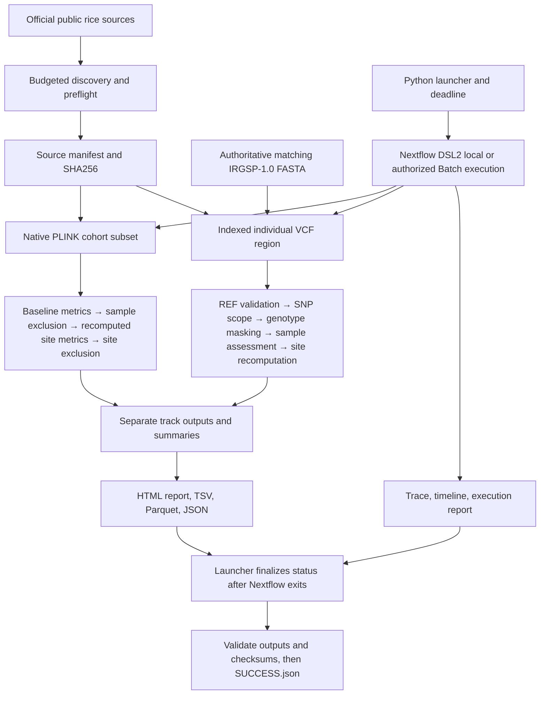

# Architecture

The launcher owns run identity and final status. Nextflow owns scheduling and task caching.
Python defines explicit scientific semantics; PLINK computes independent standard statistics.
BCFtools parses and describes the VCF; SAMtools builds the FASTA index. There is no cross-track
cohort merge. Thresholds enter task inputs as canonical JSON values so they affect cache keys.
The entire policy is a conservative dependency of both tasks; a VCF-only DP change also reruns
cohort analysis. Input FASTA is copied before indexing to avoid mutating staged symlinks and
invalidating resume unexpectedly.

Default local resource envelope: at most 4 CPUs, 8 GB scheduler RAM, two tasks simultaneously,
one thread per scientific tool and 2 GB per task. These are limits/requests, not measured peaks.
Nextflow 25.10.2 uses Java 17.0.20 locally; the audited AL2023 cloud controller used 17.0.21.
Docker jobs are linux/amd64 CPU-only.
Apple Silicon supports native development (ARM PLINK plus pysam's compiled BCFtools/SAMtools
adapters) or Docker amd64 emulation. Emulation speed cannot be extrapolated to AWS workers.

Follow-up audit: native tasks now consume an explicit source-code fingerprint as well as biological
policy and data identities. The same Python finalizer validates source attestations, Parquet/TSV/JSON
agreement and recomputed BED/VCF metrics before atomic certification. Reference and unsupported VCF
records have separate indexed outputs. The architecture and local/AWS execution boundary are unchanged.
