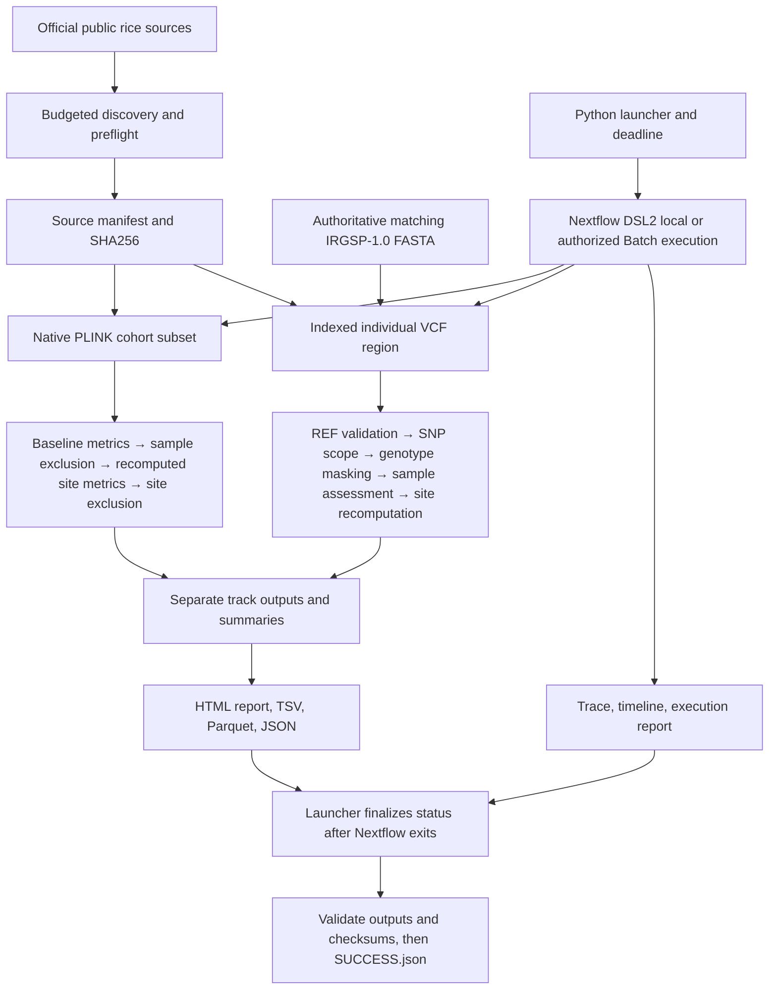

# Architecture

The launcher owns run identity and final status. Nextflow owns scheduling and task caching.
Python defines explicit scientific semantics; PLINK computes independent standard statistics.
BCFtools parses and describes the VCF; SAMtools builds the FASTA index. There is no cross-track
cohort merge. Thresholds enter task inputs as canonical JSON values so they affect cache keys.
The entire policy is a conservative dependency of both tasks; a VCF-only DP change also reruns
cohort analysis. Input FASTA is copied before indexing to avoid mutating staged symlinks and
invalidating resume unexpectedly.

Default local resource envelope: at most 4 CPUs, 8 GB scheduler RAM, two tasks simultaneously,
one thread per scientific tool and 2 GB per task. These are limits/requests, not measured peaks.
Nextflow 25.10.2 uses Java 17.0.20 locally; the audited AL2023 cloud controller used 17.0.21.
Docker jobs are linux/amd64 CPU-only.
Apple Silicon supports native development (ARM PLINK plus pysam's compiled BCFtools/SAMtools
adapters) or Docker amd64 emulation. Emulation speed cannot be extrapolated to AWS workers.

Follow-up audit: native tasks now consume an explicit source-code fingerprint as well as biological
policy and data identities. The same Python finalizer validates source attestations, Parquet/TSV/JSON
agreement and recomputed BED/VCF metrics before atomic certification. Reference and unsupported VCF
records have separate indexed outputs. The architecture and local/AWS execution boundary are unchanged.

## Dashboard publishing and hosting

The [README architecture diagrams](../README.md#architecture) show the scientific workflow and public
website as separate execution boundaries. The dashboard consumes recorded evidence through
`scripts/export_dashboard.py`; it does not call the scientific launcher. The exporter verifies recorded
success markers and artifact checksums, preserves incomplete and failed runs, and selects public fields
from the historical AWS summary. Artifact certification does not rerun biological validation.

`scripts/publish_dashboard.py` checks the exported snapshot for private metadata and produces exactly
six static files: index HTML, stylesheet, application JavaScript, logic module, SVG icon and JSON data.
The five non-HTML files have content-hashed names. The uploader publishes those assets before index,
sets explicit MIME types and cache headers, and verifies public SHA-256 digests after deployment.
Tests, raw genomic datasets, credentials, archives and internal logs are excluded from the origin.

A visitor connects over HTTPS to the default CloudFront domain. CloudFront signs S3 origin reads with
Origin Access Control; the private bucket keeps all four public-access blocks enabled and grants reads
only to this distribution. AWS WAF is associated with the distribution as required by the declared
CloudFront Free flat-rate subscription. These are static-hosting resources, separate from the Batch
controller, workers, image registry and science-data bucket used for authorized pipeline execution.

The hosting CloudFormation template declares the bucket, bucket policy, OAC, distribution, WAF ACL
and Free subscription. The publisher checks the actual plan before uploads; initial enrollment stages
a disabled distribution and enables it only after Free activation is verified. Resource identifiers are
recorded, and repeat deployments reuse the same stack. See the [hosting runbook](../infra/dashboard/README.md)
for staging costs, recurring S3 request costs, storage-credit assumptions, updates and scoped teardown.

All dashboard interaction happens in the browser. Run selection, searches, comparisons and downloads
operate on the loaded snapshot; local imports remain in browser memory and are marked as supplied
claims rather than re-certified evidence. Provenance links point to original GitHub artifacts. There is
no backend, database, workflow submission endpoint or live AWS monitoring in the dashboard.
